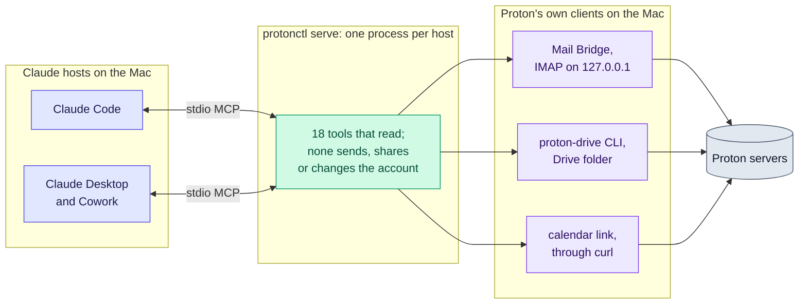

# RFC-0001: protonctl, a read-only MCP server for Proton Mail, Drive and Calendar

| | |
|---|---|
| **Status** | Accepted. Revised: read-only (Phase 1b withdrawn, Q5). A privacy layer added in that revision and made optional (Q26) was later withdrawn ([Q43](rfc-0001/10-open-questions.md#decisions-and-questions)), with Phases 3, 5, 6, 7 and P5. New work is now built and checked on macOS first (Q29). The proposed [RFC-0002](rfc-0002.md) would amend R1 to allow writes under a policy the user sets. |
| **Built** | Phase 1a: reads for Mail, Drive and Calendar. Phase 2's folders and panic hook; Phase 4's sandboxed readers. Phases P1 to P4: Linux ([section 11](rfc-0001/11-platforms.md)). |
| **Next** | [What remains](rfc-0001/09-rollout.md#what-remains) in section 9, and RFC-0002's decisions. |
| **Reviewed** | Against the code at the read-only revision. A security assessment ([docs/security-assessment.md](security-assessment.md)) replaces the security and privacy review deleted with aliases mode, whose text is no longer kept; [section 5](rfc-0001/05-security.md) lists the threats and controls. |

## At a glance

## Summary

- **One small Rust binary, `protonctl`, runs as a local MCP server over stdio
  and as a plain CLI.** It implements none of Proton's cryptography and never
  sees the Proton password or private keys: every encrypted operation goes
  through Proton's own signed clients. Its own cryptography is SHA-256 and
  SHA-1 digests of files and the pin on Bridge's TLS certificate (through
  `ring` and rustls).
- **Mail** goes through Proton Mail Bridge (local IMAP, pinned TLS
  certificate, no SMTP). **Drive** reads its namespace from the Proton Drive
  app's local folder and reads content through the official `proton-drive`
  CLI.
- **Calendar is read-only through a Full-view share link** (decision Q1).
  Proton has no calendar API; with this link Proton's server decrypts the
  calendar each time it is fetched, and changes can take up to 8 hours to
  show. **Contacts are out of scope** (no API, no CardDAV).
- **Read-only (decision Q5).** protonctl cannot send, share, draft,
  label, move or delete. Those capabilities do not exist, which is stronger
  than an approval prompt: Anthropic reports that users approve roughly 93%
  of permission prompts. The writes planned for Phase 1b are withdrawn.
- **Results as Proton's clients show them.** protonctl returns names, IDs
  and files as Proton's clients show them: a read-only stand-in for
  Claude's Google connectors. The privacy layer, decided and then made
  optional by Q26, was later withdrawn (Q43). The Claude hosts keep
  their own transcripts and logs ([section 5](rfc-0001/05-security.md)).
- **One binary serves both hosts.** Claude Code registers it with
  `claude mcp add`; Claude Desktop and Cowork read one `mcpServers` entry.
  Cowork runs local MCP servers on the Mac host, outside its VM, which is the
  only way it can reach Bridge and the Keychain.

## Constraints

- Test fixtures are synthetic; never commit real mail, files or calendar
  data, and never write real Proton data inside the repository, gitignored
  paths included.
- Gates run locally (`scripts/check.sh`, from the pre-commit hook). Install is
  `cargo install --path` from the reviewed checkout.
- macOS on Apple silicon, and Linux from Phase P (Q29): a feature with no
  Linux mechanism that meets its requirement is absent there
  ([section 11](rfc-0001/11-platforms.md)).

## Contents

| Part | What it holds |
|---|---|
| [Background](rfc-0001/background.md) | Proton's programmatic surfaces, the Claude hosts, interface conventions, design principles |
| [1. Goals and non-goals](rfc-0001/01-goals.md) | Goals, the design target, non-goals |
| [2. Requirements](rfc-0001/02-requirements.md) | R1 to R26; those that served only aliases mode are withdrawn (Q43). R27 onward are RFC-0002's |
| [3. Options considered](rfc-0001/03-options.md) | Architecture, backends, privacy-layer choices (withdrawn, Q43), language, state, packaging, gates, libraries |
| [4. Design](rfc-0001/04-design.md) | Components, command line, settings, MCP tools, results, safety model, files |
| [5. Security](rfc-0001/05-security.md) | Trust boundaries, threats and controls, residual risks |
| [6. Privacy](rfc-0001/06-privacy.md) | Disclosure and retention; the privacy layer is withdrawn (Q43) |
| [7. Testing](rfc-0001/07-testing.md) | The tests built |
| [8. Review process](rfc-0001/08-review-process.md) | What is checked at the end of each phase |
| [9. Rollout and milestones](rfc-0001/09-rollout.md) | What remains; phases and milestones as built; the withdrawn ones listed |
| [10. Open questions](rfc-0001/10-open-questions.md) | Q1 to Q43, and what was declined; Q44 onward are RFC-0002's |
| [11. Platforms](rfc-0001/11-platforms.md) | macOS and Linux: what is macOS-specific, how Rust projects handle it, Linux options per service, Phase P |
| [Appendix A](rfc-0001/appendix-a-phase-0.md) | Phase 0 findings on Bridge, the Drive CLI and the calendar feed |
| [Appendix B](rfc-0001/appendix-b-proton-code.md) | Proton's open-source code, as surveyed |
| [API specification](rfc-0001/lld-api.md) | Every tool, parameter and result field; errors; command line; config |

Three parts were deleted with aliases mode (Q43), and their text is no
longer kept: Appendix C, the role-play of aliases mode; the low-level
design of the privacy layer; and the security and privacy review.

Requirements are numbered R1 to R26 ([section 2](rfc-0001/02-requirements.md)),
open questions Q1 to Q43 ([section 10](rfc-0001/10-open-questions.md)), and
milestones M1.1 to M4.1 and MP0 to MP4 ([section 9](rfc-0001/09-rollout.md)).
[RFC-0002](rfc-0002.md) continues the numbering from R27 and Q44.
