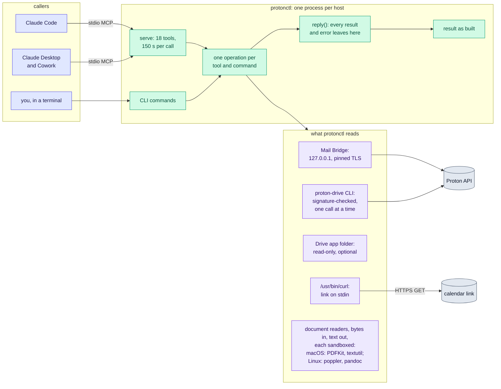
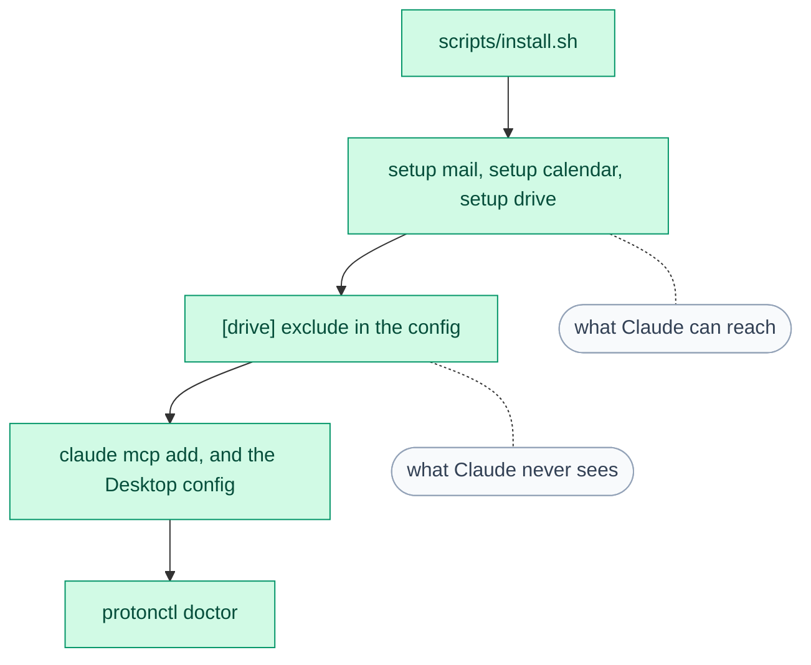
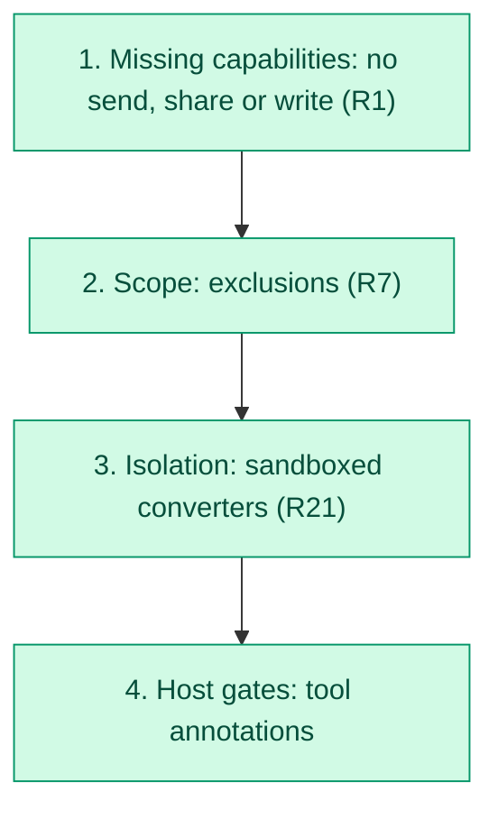

[RFC-0001](../rfc-0001.md) › 4. Design

# 4. Design

## Components



Each CLI command and MCP tool calls the same operation, so behaviour lives in
one place and the CLI has no capability the MCP surface lacks, except saving
a file where `--out` names (R10). The privacy pipeline that aliases mode
put between `reply()` and the host was withdrawn with that mode
([Q43](10-open-questions.md)).

## Command line, as built

```
protonctl serve                                   MCP over stdio
protonctl setup calendar --id ID [--name NAME]    share link on stdin; stored in the Keychain
protonctl setup mail --address USER [--port N]    Bridge password on stdin; pins Bridge's certificate
protonctl setup drive [--folder DIR] [--cli PATH] checks the Drive CLI and its sign-in; writes [drive]
protonctl doctor                                  check every service; exit 1 if any fails
protonctl status                                  what protonctl reaches and every secret it holds
protonctl logout                                  delete protonctl's Keychain items; print Proton-side revoke steps
protonctl calendar list | events | search QUERY | event EVENT_ID
protonctl drive search QUERY | ls [PATH] | stat PATH | cat PATH | get PATH [--out DIR] | tree [PATH] | manifest [PATH]
protonctl mail search QUERY | count QUERY [--by FIELD] | message MESSAGE_ID | thread THREAD_ID | labels
protonctl mail attachment MESSAGE_ID INDEX [--out DIR]
```

Output is JSON on stdout; logs go to stderr. Exit codes: 0 success, 1 failure,
2 usage error. Writes were withdrawn (Q5);
[RFC-0002](../rfc-0002.md) proposes them again, behind a policy. `setup privacy` and
`rotate-key` were withdrawn with aliases mode (Q43). An older version could
leave the secret-store items `privacy-mode` and `privacy-key` and the name
model's folder (`~/Library/Application Support/protonctl` on macOS,
`$XDG_DATA_HOME/protonctl` on Linux). `doctor` prints a `note` line that
names each one it finds, with the command that deletes each item, and
`logout` deletes the items.

## Settings

Proposed with Q26 and confirmed, with Q27 (no mode until the user
chooses) and Q28 (the mode in the Keychain). The privacy mode, the choice
of what Claude sees, was withdrawn with aliases mode
([Q43](10-open-questions.md)), and with it Q27, Q28 and R26.

A user makes two choices. Everything else is found automatically, or is
not a setting.



| Choice | Made by | Values |
|---|---|---|
| What Claude can reach | one setup command per service; a service is on only once set up | `setup mail`; `setup calendar`, once per calendar; `setup drive` |
| What Claude never sees | `[drive] exclude` in the config | Drive paths |

- **Services.** Mail and each calendar are on once set up, as built.
  Since M1.4, so is Drive: `protonctl setup drive` checks
  the CLI (its signature on macOS; on Linux it pins its SHA-256) and its
  sign-in, finds the app's folder and writes a `[drive]` table, and Drive
  is on only when the config has that table.
  A config that already has one keeps working; one without it loses
  Drive until `setup drive` runs, and `doctor` and `status` say so.
  A new install works once each service it uses is set up; there is no
  setup step for privacy.
- **Results.** Results come as built: names, Proton IDs, digests, page
  images, and the download and export folders. The 18 tools are a
  read-only stand-in for Claude's Gmail, Calendar and Drive connectors.
- **Exclusions** stay as built (R7). Mail labels have none (declined).
- **Found automatically, set only to override:** `time_zone`,
  `[drive] folder` and `cli`, `[mail] port`. Optional, and off until set:
  `[export] folder`.
- **Not settings:** read-only (R1), secrets in the Keychain (R2), the
  network rule (R3), tool hints (R4), hidden characters and provenance
  (R6), exclusions (R7), the time limit (R8), the signature check and the
  certificate pin (R9), calendar freshness (R12), sandboxed converters
  (R21) and clean logs (R25). None of these costs the user anything a
  setting could give back, so a switch would only be a way to lose one by
  mistake.

## MCP tools

Registered in both hosts as `proton`, which is what tool names and
permission rules use; the server calls itself `protonctl`. The
[API specification](lld-api.md#mcp-tools) gives each tool's parameters
and result fields.

| Tool | Kind | Backend | State |
|---|---|---|---|
| `get_status` | read | all | built |
| `list_calendars`, `list_events`, `search_events`, `get_event` | read | ICS link | built |
| `search_files`, `list_folder`, `get_file_metadata`, `read_file_content` | read | folder, else CLI | built; files not on this Mac come through the CLI; without the app's folder, list and stat do too and search is off; `read_file_content` returns text a page at a time, PDF and document text through `protonctl convert`'s sandbox: PDFKit and `textutil` on macOS (Q13), poppler and pandoc on Linux ([section 11](11-platforms.md#the-document-readers-as-built-p4)), a PDF's pages (a scan's unasked) as images, and images as image content |
| `list_drive_tree` | read | folder, CLI for SHA-1 | built; a page of rows at a time, by a cursor that names the folder in progress |
| `download_file` | read | CLI | built; `export: true` saves into the export folder, `inline: true` returns the bytes as an embedded resource (R10) |
| `export_drive_manifest` | local write | folder, CLI for SHA-1 | built; writes into the export folder only (R10) |
| `search_threads`, `count_messages`, `get_thread`, `get_message`, `list_labels`, `get_attachment` | read | Bridge | built |
| `create_draft`, `update_draft`, `modify_messages`, `trash_messages`, `create_folder`, `upload_file`, `move_files`, `restore_files`, `trash_files` | write | Bridge, CLI | withdrawn (R1); [RFC-0002](../rfc-0002.md#tools) proposes a different set |

Claude Code allow rules for the tools that only read:
`mcp__proton__get_status`, `mcp__proton__get_event`,
`mcp__proton__get_file_metadata`, `mcp__proton__get_message`,
`mcp__proton__get_thread`, `mcp__proton__list_*`, `mcp__proton__search_*`,
`mcp__proton__count_*`, `mcp__proton__read_*`.
`get_attachment`, `download_file` and `export_drive_manifest` can leave
files behind (the download folder for an hour, the export folder until
someone deletes them), so they stay on ask, and since M1.6 all three are
marked `readOnlyHint: false`. Whether Claude Code matches a
glob inside a tool name, rather than only a whole server or one tool, is
not checked; if it does not, the rules list each tool by name. The
`reveal_*` tools that aliases mode planned behind Touch ID (Phase 3) were
withdrawn by Q43.

## Results and untrusted content

Results are compact JSON. Each names its
third-party-authored fields in `provenance`, reports
`hiddenCharactersRemoved`, and marks truncation. The server's `instructions`
state the convention once. Tool parameters reject unknown names, so a
misspelled `start_time` is an error the model can correct rather than a
silently ignored value; `search_events` is the exception, since it flattens
`list_events`' window and serde cannot check unknown names through a
flattened struct.

## Safety model

Strongest layer first; revised for a read-only connector. The
two layers of aliases mode, tokenized results (R13 to R17) and Touch ID
before raw content (R18, R19), were withdrawn
([Q43](10-open-questions.md)).



1. Missing capabilities (R1): no send, share or write, so nothing to approve
   and nothing to trick.
2. Scope: exclusions (R7).
3. Isolation: converters run in a sandboxed helper (R21).
4. Host gates: annotations for Desktop and Cowork.

No layer hides what a result holds from the host's model provider.
None of these layers reaches the host's other tools in the same session
(a web fetch, a shell, another connector), which injected text can use to
send on whatever protonctl returned ([section 5](05-security.md)).

## Files

| What | Where |
|---|---|
| Binary | `~/.cargo/bin/protonctl`, signed from Phase 2 with a self-signed certificate in the login keychain (Q12) |
| Config | `~/.config/protonctl/config.toml` (no secrets; format in `src/config.rs`) |
| Secrets | Keychain service `protonctl`, accounts `calendar/<id>`, `bridge/<address>`; the items `privacy-mode` and `privacy-key` that an older version made are named by `doctor` and deleted by `logout` (Q43) |
| Downloads | `~/Library/Caches/protonctl/downloads/<pid>/<drive or mail>-<Unix seconds>-<random>/` (mail attachments and Drive files; the sweep reads each folder's age from its name) |
| Drive CLI lock | `~/Library/Caches/protonctl/cli.lock`, always empty; every protonctl process locks it around a run of `proton-drive` (principle 6, Q37) |
| Exports | the folder `[export] folder` names: `drive/<Drive path>`, `mail/<messageId>/<index>-<name>`, `manifests/drive-<UTC time>.jsonl` |
| Name model, from an older version | `~/Library/Application Support/protonctl`; on Linux `$XDG_DATA_HOME/protonctl`; no longer used, and named by `doctor` if it is there (Q43) |
| On Linux | the cache under `$XDG_CACHE_HOME/protonctl` (else `~/.cache/protonctl`); secrets in the Secret Service, with the attributes `service` and `account` (Q31, [section 11](11-platforms.md)) |
| Not protonctl's, but holding its results | Claude Code's transcripts under `~/.claude/projects/`; Claude Desktop's logs under `~/Library/Logs/Claude/` ([section 5](05-security.md)) |

---

[← 3. Options considered](03-options.md) · [Contents](../rfc-0001.md#contents) · [5. Security →](05-security.md)
