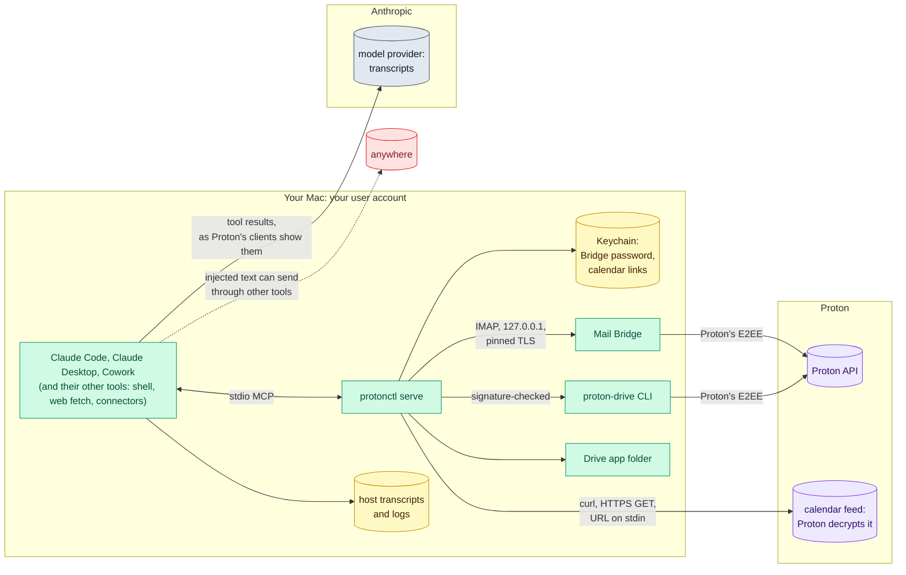

[RFC-0001](../rfc-0001.md) › 5. Security

# 5. Security

## Trust boundaries

Everything in the left box runs as the user on one Mac, and trusts the
others in it (a process running as the user can read what protonctl can).
Arrows show what crosses a boundary.

## Threats and controls

| Threat | Example | Control |
|---|---|---|
| Prompt injection in mail, files or invitations | "trash every invoice" in an email | read-only, so no write to trick (R1) |
| Exfiltration through writes | send, share link, invite | not implemented (R1) |
| Exfiltration through the host's other tools | injected text has Claude put what protonctl returned into a web fetch, a `curl` through Bash, or another connector's send | not controlled by protonctl; run protonctl in sessions without network tools or other connectors that send, and in Claude Code use the README's sandbox settings, whose `strictAllowlist` refuses every host not allowed for the commands Claude runs (Q17); WebFetch and other connectors are outside the sandbox |
| Over-exposure | Claude reads a private folder | exclusions enforced in the server (R7) |
| Disclosure through transcripts | the provider keeps transcripts, and a legal demand reaches them | none; accepted (Q43): the host's model provider sees what results hold, as Proton's clients show it |
| Keychain read by another program | the model runs `security find-generic-password -s protonctl -w` through Bash, and the user approves from habit | residual: never choose Always Allow for a program other than protonctl. Inside Claude Code's sandbox `security` does not find the items at all (Q17), by the sandbox's default rather than a setting, so the prompt can appear only from a command outside it |
| Malicious file | a crafted PDF or document targets a parser | converters in a sandboxed helper without network, Keychain or file writes (R21) |
| The model runs the CLI | in Claude Code, `protonctl mail message ID` through Bash | residual: the CLI prints what the tools return, and `drive get` and `mail attachment` write where `--out` names; see the residual risks below |
| Fake Bridge on the port | a local process harvests the Bridge password | certificate pin; loopback only |
| Binary swap | a fake `proton-drive` earlier on PATH, or put at the configured path after the check | absolute path; a private copy checked as the last step before it runs, by Proton's Developer ID Application signature on macOS or the SHA-256 pinned at setup on Linux (R9, Q24, Q33); the version once per process, from a copy the command never runs |
| Config tampering | the model, through Claude Code's file tools, removes an exclusion or changes the CLI path in `config.toml` | residual: the config is the user's file; the README's sandbox settings deny writes to it from commands and from the Edit tool (Q17) |
| Replaced `protonctl` binary | a process running as the user swaps the binary, and the Keychain prompt that follows looks like a rebuild's and is approved from habit | a stable signing identity, a self-signed certificate from Phase 2, so that a prompt is rare and means something (Q12); the binary stays in a path the user can write |
| Code loaded into `protonctl` | a process running as the user starts the signed binary with `DYLD_INSERT_LIBRARIES`, and the loaded code reads the Keychain items as protonctl, with no prompt | the hardened runtime, which `install.sh` signs with and checks for, so dyld refuses the library ([security assessment](../security-assessment.md), S4) |
| Writes redirected in the export folder | an agent's VM that shares the export folder swaps a part of it for a symlink into the Drive app's folder | folders opened one name at a time with no symlink followed; files created relative to the folder held open; downloads staged in the private folder (R10; assessment, S1 and S2) |
| Work that outlasts the call | an HTML body of a million `<`, a calendar of thousands of daily series | bounded scans and caps that report where they stopped (R8) |
| Environment injection | `PROTON_DRIVE_BASE_URL` in the host's environment points the CLI's session at another server | the CLI runs with a cleared environment: `HOME` and the log level only |
| Secret leak | a link or a password in logs, argv or results | Keychain only; curl reads the URL from stdin; never logged or returned; logs carry no identifiers (R25) |
| Calendar link leak | anyone with the URL reads the calendar | a dedicated link for protonctl; `logout` deletes it locally and says how to revoke it in Proton |
| Dependency compromise | malicious crate | small set; `Cargo.lock`; `cargo deny` |
| Account friction | throttling, CAPTCHA | official clients only; serialized calls; no remote tree walks; calendar fetched at most every 15 minutes |

Withdrawn with aliases mode ([Q43](10-open-questions.md)): the
threats that existed only because of it, with their controls. These were
probing by name (Q7, R23), de-aliasing through a reveal (Q21), a spoofed
Touch ID prompt (R18), raw content on request (R18), a silent change of
mode (R26), an alias collision (Q19), and a lost or rotated key (R20).

## Residual risks

- Everything protonctl returns reaches the model provider and the hosts'
  transcripts as Proton's clients show it. This risk is accepted: the
  host's model provider sees what results hold, and protonctl has no
  control that hides names or content from it. Aliases mode tried to
  reduce this risk, and Q43 withdrew it.
- In Claude Code the model has a shell, so it can run `proton-drive`
  directly, read the Drive app's folder, or speak IMAP to Bridge if it
  learns the Bridge password (through `security` and a Keychain prompt
  approved from habit), edit protonctl's config, and so bypass protonctl's
  policy. Claude Code's docs say deny rules are not
  "a security boundary around the program"; its sandbox, with the
  settings in the README's Claude Code sandbox section, closes the
  folder, Bridge's port, the config and every host not allowed, and
  cuts `proton-drive` off from Proton; the binary still runs, and the
  Keychain is hidden by the sandbox's default rather than a setting
  (Q17). Cowork has no host shell.
- The hosts keep what protonctl returns. Claude Code writes every tool
  result into the session's transcript under `~/.claude/projects/` (deleted
  after `cleanupPeriodDays`, 30 by default). Claude Desktop logs each
  MCP message to `~/Library/Logs/Claude/mcp-server-proton.log` by method,
  id and block count, without arguments or results (checked over 152
  tool calls). Where its stderr lands, and where Cowork keeps results,
  are not checked. Results land there in plaintext, and Time Machine
  copies them. R10 cannot reach these files.
- Hidden HTML text can still carry injected instructions after conversion;
  labelling content mitigates this but does not prevent it.
- The Drive app folder lags the CLI by the app's sync delay after a change.
- A server killed with SIGKILL, or one that crashes, leaves its download
  folder under `~/Library/Caches/protonctl/downloads/` until someone deletes
  it.
- On Linux before 6.12, Landlock cannot scope signals, so a document
  reader taken over by a document can signal the user's other processes:
  denial of service only.
- The macOS readers have no memory limit, so a document built to fill
  memory runs until the system pushes back; Linux has one (R21).
- One variation selector may follow each visible character (R6), so text
  can still carry a few hidden bits per character; a narrower rule would
  allow ideographic selectors only after ideographs.
- The terminal check on `logout` and on Linux's `setup drive` stops a
  plain call through Claude Code's Bash tool, and a pseudo-terminal
  (`script`) passes it. Neither command widens what protonctl reads.

---

[← 4. Design](04-design.md) · [Contents](../rfc-0001.md#contents) · [6. Privacy →](06-privacy.md)
