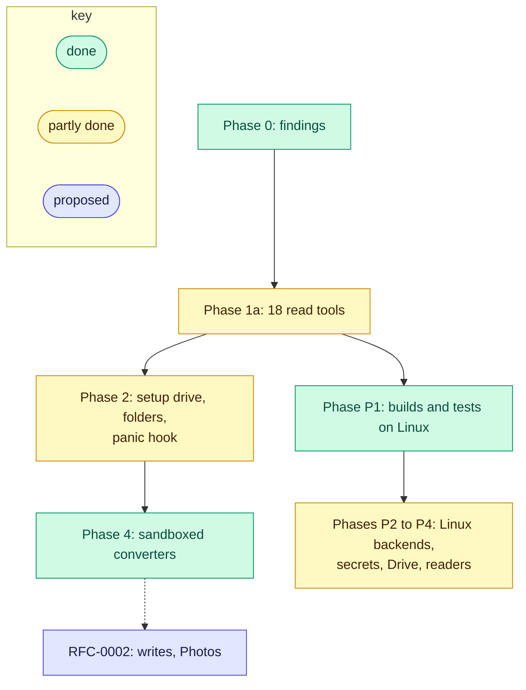

[RFC-0001](../rfc-0001.md) › 9. Rollout and milestones

# 9. Rollout

## What remains

Taken after Q43 removed aliases mode. macOS first (Q29); the Linux work
is tracked apart. Writes and new services are [RFC-0002](../rfc-0002.md)'s.

| # | What | Needs |
|---|---|---|
| 1 | M1.1, the host tests: Claude Desktop, Cowork on the Mac, a Cowork cloud task; whether allow-rule globs such as `mcp__proton__list_*` match | the maintainer, at the Mac |
| 2 | D8's live check: a folder made online-only in the Drive app, listed through the CLI. When it was tried, the only online-only folder was the File Provider's own `.Trash`, so the check did not count | the maintainer makes a folder online-only |
| 3 | The Mac checks that still apply: a backslash inside a Drive name (L6), then `logout` last | the maintainer, at the Mac |
| 4 | A memory limit for the macOS readers, which have none (Q13); Linux has one | code |
| 5 | The first release: a tag and the `release` branch Q36 names. The README tells users to install from a tag, and none exists | the maintainer, since a tag publishes |
| 6 | Drive CLI 0.9.0: widen `SUPPORTED` after the Drive tests and the live check pass on it | the maintainer's CLI update, then code |
| 7 | The prompt-injection drill (T12). Optional while protonctl only reads; required before any write (RFC-0002, R33) | a few Claude runs |
| 8 | The [security assessment](../security-assessment.md)'s open items: build and test its fixes on Linux, which were made and checked on macOS only; move calendar expansion off the async thread | code |
| 9 | RFC-0002's decisions, Q44 to Q51 | the maintainer |
| 10 | Decode Bridge's modified UTF-7 mailbox names, so a non-ASCII label shows as written ([Appendix A](appendix-a-phase-0.md)) | code |

## Phases

| Phase | Contents | State |
|---|---|---|
| 0 | Install Bridge, log in, enable All Mail, IMAP over SSL; measure the `--noninteractive` cold start; record `X-Pm-*` headers, UIDPLUS, BODY search on encoded parts; record the CLI's path format, JSON shapes and `fs info` fields; create a dedicated calendar link and note its caching headers. Findings go in [Appendix A](appendix-a-phase-0.md). | Recorded ([Appendix A](appendix-a-phase-0.md)) |
| 1a | `serve`, `setup`, `doctor`, `status`, `logout`; read tools for Mail, Drive and Calendar; registration in both hosts; Cowork local and cloud test | 18 tools built; the full live run passed (M1.2); Claude Code passed; Claude Desktop and Cowork have not run (M1.1) |
| 2 | `setup drive`; `download_file`, `export_drive_manifest`, the CLI's `drive manifest`, the `export` and `inline` options, the export and download folders, page images, image content and inline bytes; a panic hook (R25); the `live-check.py` checks | built; D8's live check is open |
| 4 | PDFKit and `textutil` behind `protonctl convert` under a sandbox profile; on Linux, poppler and pandoc (MP4) | built (M4.1, Q13); no memory limit on macOS yet |
| P0 to P4 | Linux ([section 11](11-platforms.md)): builds and tests (P1), Mail and Calendar (P2), Drive (P3), converters (P4) | built; the live checks of P2 and P3 have not run |

Withdrawn, with their milestones: Phase 1b, writes (Q5;
[RFC-0002](../rfc-0002.md) proposes writes again); Phases 3, 5, 6 and 7
and P5, with aliases mode (Q43). Their text, as planned, is no longer
kept.

## Milestones

Each milestone ends when its exit check passes; code locations are those
of the time of writing.

### Phase 1a

- M1.1 Host tests. Register with `claude mcp add` and in
  `claude_desktop_config.json`; run `get_status` from Claude Code, Claude
  Desktop, Cowork on the Mac and a Cowork cloud task. Check whether the
  allow rules' globs (`mcp__proton__get_*`) match, and record where each
  host keeps tool results and stderr. Exit: findings in
  [Appendix A](appendix-a-phase-0.md); the allow rules in [section 4](04-design.md) and the README corrected if the
  globs do not match. Claude Code done (Appendix A, Hosts); no allow rule
  for protonctl was configured, so the globs are not checked. Claude
  Desktop, Cowork and the cloud task have not run.
- M1.2 A full `scripts/live-check.py` run over all 18 tools. Done against
  the installed binary: all 18 tools passed; two `download_file` calls
  took 4.3 s and 4.7 s, and `export_drive_manifest` wrote a complete
  manifest of 19,364 rows. A later run failed the PDF page-image check,
  because the script took the first PDF over 1 KB, which was over the
  64 MiB read limit. It now takes a PDF of 1 KB to 64 MiB, and the run that followed passed
  every check, page images included (4 images, 4 labels).
- M1.3 Say read-only where the model reads it. Done: the server's
  `instructions` and `get_status`'s `cannot` both hold `serve::CANNOT`,
  and a test failed when a word was dropped from the
  instructions.
- M1.4 Drive set up like the other services: `protonctl setup drive`
  checks the CLI's signature and sign-in, finds the app's folder and writes
  `[drive]`; Drive is on only with that table. Built; the exit test
  failed against the old automatic Drive.
- M1.5 R6 in Drive errors: escape paths and `clean` the CLI's text in
  every error. Done: three tests with U+202E in a file name and in the
  stand-in CLI's output failed first, each showing it raw.
- M1.6 Hints that match what each tool does: `readOnlyHint` and
  `idempotentHint` false for `download_file` and `get_attachment`, which
  can save files that outlive the call. Done (the surface snapshot).

### Phase 2

- M2.7 `download_file` and `export_drive_manifest`, the export and
  download folders, the sweep, page images and inline bytes. Done (the
  surface snapshot and the forbidden-name tests).
- M2.9 Logs: a panic hook that prints the code location and never the
  message. Done; protonctl's logs carry no identifiers, so no log key
  was built (R25).
- M2.10 `scripts/live-check.py`, the README and the tool descriptions
  updated. Done, with the live run of M1.2.
- D8 A folder made online-only in the Drive app listed as empty, with no
  note. Fixed: `list_folder` lists such a folder through the CLI, with a
  note, or says its contents are not on this computer when the CLI cannot, and a tree row marks it `cloudOnly`. Not yet checked live.
- M3.4 Document the Claude Code sandbox settings (Q17). Done on
  Claude Code 2.1.293, macOS only: the README's [Claude Code
  sandbox](../../README.md#claude-code-sandbox) section, each denial
  seen with the settings and its probe seen to pass without them.

### Phase 4

- M4.1 Answer Q13; the sandbox profile; PDFKit and `textutil` under it.
  Built: the readers run behind `protonctl convert` under a `(deny default)`
  `sandbox-exec` profile, and `doctor` reads a sample through each. The
  macOS probe (`the_sandbox_confines_a_reader` in `src/platform/macos.rs`)
  and `tests/convert.rs` pass, and fail with writes, the network, Mach
  services or new processes allowed. No memory limit on macOS yet.

### Phase P: platforms

- MP0 Answer Q30 to Q35 and confirm what ships for Linux. Done
  ([section 11](11-platforms.md#linux-availability-mp0-findings)).
- MP1 Builds and tests on Linux. Done: the gate passes on Linux, no
  snapshot changed, and from Linux the gate also lints the macOS build.
- MP2 Mail and Calendar on Linux: the Secret Service (Q31), Bridge started
  by the user (Q32), `setup`, `doctor`, `status`. Built
  ([section 11](11-platforms.md#the-secret-service-as-built-p2)); the live
  check on a Linux desktop has not run.
- MP3 Drive on Linux as Q33 decides. Built; since a later change the pin
  lives in the Secret Service and each call runs the sealed memfd copy it
  checked. The live check has not run.
- MP4 Converters and their sandbox on Linux (Q34). Built
  ([section 11](11-platforms.md#the-document-readers-as-built-p4)): the
  sandbox test passes, and fails without the seccomp filter or with all of
  `/etc` readable.

---

[← 8. Review process](08-review-process.md) · [Contents](../rfc-0001.md#contents) · [10. Open questions →](10-open-questions.md)
